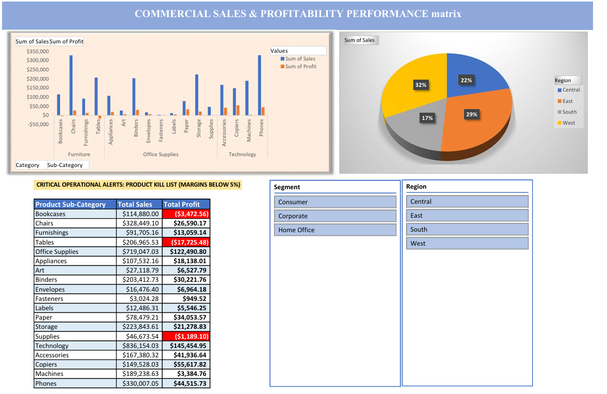

# Commercial Sales & Profitability Performance Dashboard

## Project Overview

An interactive Microsoft Excel dashboard developed using the Sample Superstore dataset to analyse commercial sales performance and profitability.

The dashboard provides an executive-level view of key business indicators, helping stakeholders understand sales trends, evaluate product profitability, identify loss-making sub-categories and compare regional performance.

## Dashboard Preview

## Business Objectives

- Monitor overall sales and profitability performance.
- Identify high-performing and loss-making product sub-categories.
- Evaluate sales distribution across geographical regions.
- Compare business performance across customer segments.
- Provide actionable insights to support data-driven decisions.

## Dashboard Features

- Interactive Excel dashboard with dynamic filtering.
- Sales and profit analysis by product sub-category.
- Regional sales distribution visualisation.
- Identification of low-margin and loss-making products.
- Region and customer segment slicers.
- Conditional formatting for profitability monitoring.
- Executive-level performance reporting.

## Key Business Insights

- Technology generated the highest overall profit among the product categories.
- Phones and Chairs were among the leading revenue-generating sub-categories.
- The West region contributed the largest share of total sales.
- Tables, Bookcases and Supplies recorded negative profitability, indicating areas requiring further investigation.
- Interactive slicers enable users to explore performance across different regions and customer segments.

## Tools and Techniques

| Tool / Technique | Application |
|---|---|
| Microsoft Excel | Data analysis and dashboard development |
| Pivot Tables | Data summarisation and aggregation |
| Pivot Charts | Visual representation of business performance |
| Slicers | Interactive filtering by region and segment |
| Conditional Formatting | Highlighting profitability risks |
| Dashboard Design | Executive reporting and insight presentation |

## Business Value

The dashboard supports business decision-making by helping stakeholders:

- Monitor sales and profit performance.
- Identify profitable and underperforming products.
- Evaluate regional sales contributions.
- Detect potential profitability risks.
- Explore business performance through interactive filters.

## Dataset

**Source:** Sample Superstore Dataset

The dataset contains sales transactions and business information, including product categories, sub-categories, customer segments, geographical regions, sales and profit.

## Project Files

- Excel workbook (`.xlsx`) — Interactive dashboard and analysis.
- Dashboard screenshot (`.png`) — Static preview of the dashboard.

## Author

**Sagal Mohamed**

GitHub: https://github.com/Salugla

